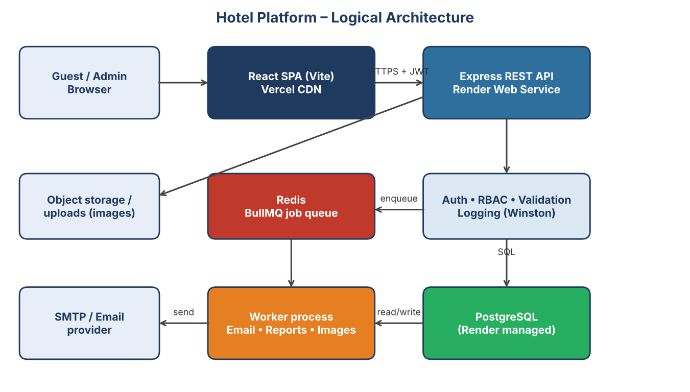
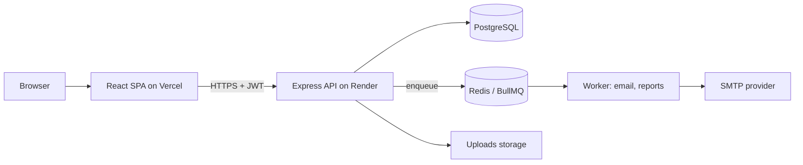
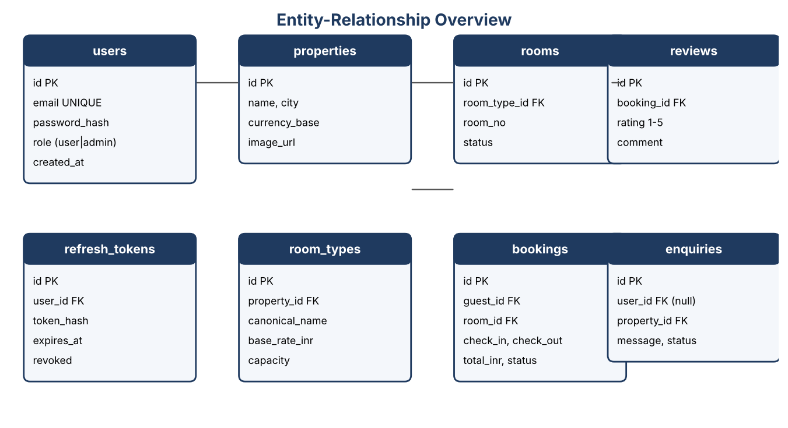

# Architecture

## Key decisions
| Decision | Reason |
|---|---|
| PostgreSQL exclusion constraint on bookings | Double bookings are impossible even under concurrent requests |
| Access JWT (15 min) + rotating hashed refresh token in httpOnly cookie | Short-lived API credentials, revocable sessions, theft detection |
| Seed pipeline with `data_quality_log` | Every correction to messy source data is auditable |
| Queue falls back to in-process when `REDIS_URL` is unset | Works on free hosting; scales to a real worker when Redis is added |

## Data model

